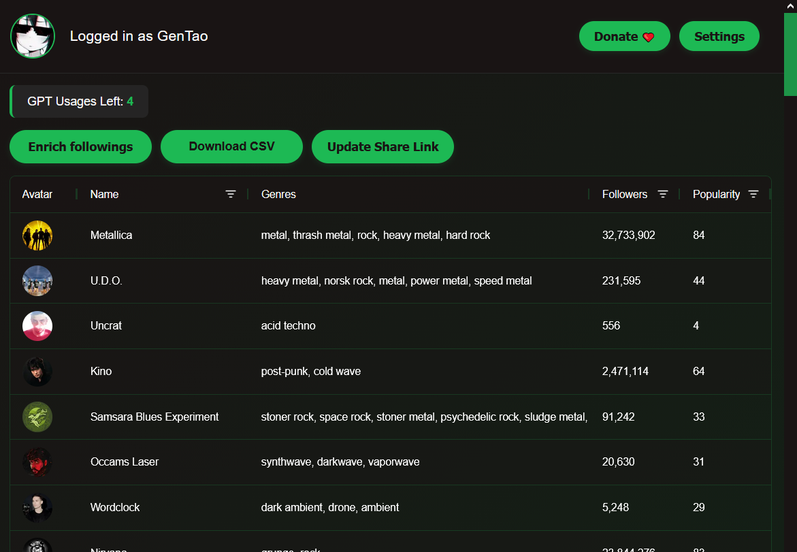
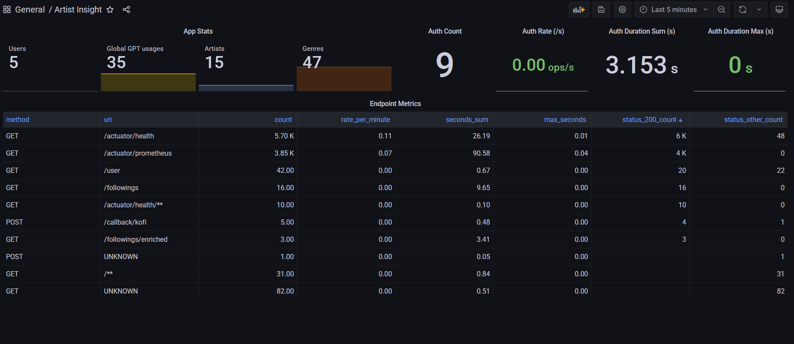

## artist-insight
A service that allows you to fetch your Spotify followings and share them with others.

### Features
- Fetch user followings and show them with genres in a list
- Download the followings list as a CSV file
- Share followings page with a share link
- Define missing artist genres using OpenAI
- Log in with a Spotify user using OAuth



### Roadmap
- Add more ways to donate to the service
- Add selectors for grouping artists by details like genre
- Review site design
- Adopt site for mobile devices
- Add Liked Songs details list
- Add more music service integrations

### Project structure
- Backend - Kotlin Spring Boot 4 application on Maven
- Frontend - TypeScript Next.js with client and server parts
- Deployment - Docker Compose template with backend, frontend, Postgres, and Flyway

### How to run
#### Backend
The project has all its resources stubbed for the most comfortable local development. It has a list of profiles for any running requirements.

| Profile      | Resource    | Description                                                        |
|--------------|-------------|--------------------------------------------------------------------|
| stub-spotify | Spotify     | WireMock stub with stubbed endpoints                   |
| prod-spotify | Spotify     | Production configuration that requires Spotify project credentials |
| stub-openai  | OpenAI      | WireMock stub with stubbed endpoints                   |
| prod-openai  | OpenAI      | Production configuration that requires OpenAI project api key      |
| h2           | Postgres    | H2 in-memory database                                              |
| postgres     | Postgres    | Regular Postgres configuration for a local or remote instance      |
| stub-kofi    | Ko-Fi       | Stub Spring MVC endpoint that generates Ko-Fi webhook              |
| prod-kofi    | Ko-Fi       | Production configuration that requires verification token          |
| stub-mail    | Email       | Stub mail sender that logs outgoing messages without SMTP delivery |
| prod-mail    | Email       | Production SMTP configuration for sending emails                   |
| local        | No resource | Common local configurations for development                        |

Only one profile from a resource group can be used. For example, the set for the production environment looks like
`postgres,prod-spotify,prod-openai,prod-kofi,prod-mail`, and for local development - `h2,stub-spotify,stub-openai,stub-kofi,stub-mail,local`.

Use IntelliJ to run the backend locally. Add a Run/Debug configuration with Main class `org.taonity.artistinsightservice.MainKt`
and VM options `-Dspring.profiles.active=h2,stub-spotify,stub-openai,stub-kofi,stub-mail,local` and run the backend.

To run it from PS use a command like this:
```bash
mvn spring-boot:run '-Dspring-boot.run.jvmArguments="-Dspring.profiles.active=h2,stub-spotify,stub-openai,stub-kofi,stub-mail,local"'
```

#### Frontend
I recommend opening /frontend directory in Visual Code. Run `npm install`, and then `npm run dev`.

### Docker Compose deployment

Build local images:

```bash
mvn -P build-docker-image package -DskipTests
docker build -t generaltao725/artist-insight-frontend frontend/
```

Start the isolated stub stack (frontend on port 3002):

```bash
docker compose --env-file templates/docker/.test-env -f templates/docker/docker-compose.yml -f templates/docker/docker-compose.ports-local.yml up -d
```

Production additionally uses `docker-compose.prodenv.yml`. See [Operations](docs/OPERATIONS.md) for deployment variables, networks, backups, and migration requirements.

### Environment variable
Environment profiles own stable URLs, cookies, database topology and limits. Supply service credentials and select `SPRING_PROFILES_ACTIVE` / `FRONTEND_PROFILE`; see [Operations](docs/OPERATIONS.md) for the fictional demo command and profile overrides.

| Env var                              | Service  | Description                                                         |
|--------------------------------------|----------|---------------------------------------------------------------------|
| COMPOSE_PROJECT_NAME                 | Postgres | Name for Docker Compose project                                     |
| POSTGRES_USER                        | Postgres | Used by Flyway                                                      |
| POSTGRES_PASSWORD                    | Postgres | Used by Flyway                                                      |
| POSTGRES_APP_USER                    | Postgres | Used by backend                                                     |
| POSTGRES_APP_PASSWORD                | Postgres | Used by backend                                                     |
| SPOTIFY_CLIENT_ID                    | Backend  | Taken from Spotify developer dashboard                              |
| SPOTIFY_CLIENT_SECRET                | Backend  | Taken from Spotify developer dashboard                              |
| ADMIN_EMAIL                          | Backend  | Admin email address for receiving development access requests       |
| ORGANISATION_EMAIL                   | Backend  | Gmail account used for sending emails via SMTP                      |
| ORGANISATION_EMAIL_PASSWORD          | Backend  | Password/app password for the organisation Gmail account            |
| OPENAI_API_KEY                       | Backend  | Taken from OpenAI platform organisation                             |
| KOFI_VERIFICATION_TOKEN              | Backend  | Taken from Ko-Fi API webhook settings                               |
| SPRING_PROFILES_ACTIVE               | Backend  | See the table in [backend](#backend)                                |
| FRONTEND_PROFILE                     | Frontend | Select local, demo, stage or prod topology                          |
| CONSOLE_OWNER_EMAILS                  | Backend  | Comma-separated Spotify account emails for owner bootstrapping       |

### PostgreSQL database ERD diagram

```mermaid
%%{init: {"theme":"base","look":"classic","htmlLabels":true,"fontFamily":"Verdana, sans-serif","layout":"dagre","themeVariables":{"fontSize":"12px","primaryColor":"#ffffff","primaryBorderColor":"#bcc9d8","primaryTextColor":"#20344d","lineColor":"#7196bd","edgeLabelBackground":"transparent"},"themeCSS":".schema-table{border-collapse:collapse;white-space:nowrap;font:12px/1.3 Verdana,sans-serif;color:light-dark(rgb(32 52 77),rgb(220 229 241));background-color:light-dark(rgb(255 255 255),rgb(24 32 43));border:1px solid light-dark(rgb(188 201 216),rgb(82 97 116));}.schema-table th,.schema-table td{font:12px/1.3 Verdana,sans-serif;}.schema-table th{padding:3px 6px;text-align:center;font-weight:600;background-color:light-dark(rgb(232 238 245),rgb(42 53 68));}.schema-table td{padding:2px 6px;text-align:left;border-top:1px solid light-dark(rgb(229 235 242),rgb(52 65 83));}.schema-table .typeText{background-color:light-dark(rgb(220 245 239),rgb(23 61 56));color:light-dark(rgb(15 118 110),rgb(167 223 210));}.schema-table .typeNumber{background-color:light-dark(rgb(225 237 255),rgb(31 53 87));color:light-dark(rgb(29 78 216),rgb(182 206 255));}.schema-table .typeDateTime{background-color:light-dark(rgb(238 229 255),rgb(56 42 80));color:light-dark(rgb(126 34 206),rgb(217 186 243));}.schema-table .typeBoolean{background-color:light-dark(rgb(255 240 207),rgb(68 54 30));color:light-dark(rgb(146 64 14),rgb(242 208 140));}.schema-table .typeBinary{background-color:light-dark(rgb(252 229 239),rgb(72 38 55));color:light-dark(rgb(190 24 93),rgb(240 186 208));}.schema-table .typeStructured{background-color:light-dark(rgb(232 231 255),rgb(44 43 80));color:light-dark(rgb(67 56 202),rgb(198 195 250));}.schema-table .typeOther{background-color:light-dark(rgb(224 243 252),rgb(34 60 73));color:light-dark(rgb(20 100 126),rgb(176 221 235));}.schema-table .primaryKey{background-color:light-dark(rgb(255 240 207),rgb(68 54 30));color:light-dark(rgb(146 64 14),rgb(242 208 140));}.schema-table .foreignKey{background-color:light-dark(rgb(225 237 255),rgb(31 53 87));color:light-dark(rgb(29 78 216),rgb(182 206 255));}.schema-table .uniqueKey{background-color:light-dark(rgb(238 229 255),rgb(56 42 80));color:light-dark(rgb(126 34 206),rgb(217 186 243));}.schema-edge{display:inline-block;padding:2px 4px;text-align:left;font:12px/1.3 Verdana,sans-serif;color:light-dark(rgb(32 52 77),rgb(220 229 241));background:light-dark(rgb(232 238 245),rgb(42 53 68));}.schema-table,.schema-edge{color-scheme:light dark;}@scope ([data-color-mode=dark],.vscode-dark,.vscode-high-contrast,[data-theme=dark]){.schema-table,.schema-edge{color-scheme:dark;}}@scope ([data-color-mode=light],.vscode-light,.vscode-high-contrast-light,[data-theme=light]){.schema-table,.schema-edge{color-scheme:light;}}","flowchart":{"padding":0.01,"wrappingWidth":100000,"rankSpacing":24,"nodeSpacing":18,"curve":"linear","subGraphTitleMargin":{"top":0,"bottom":0}}}}%%
flowchart TB
subgraph row_0[" "]
direction LR
table_0["<table class='schema-table'><thead><tr><th colspan='3'>app_settings</th></tr><tr><th>Column name</th><th>Data type</th><th>Constraints</th></tr></thead><tbody><tr><td>id</td><td class='typeNumber'>int</td><td class='primaryKey'>PK</td></tr><tr><td>global_gpt_usages_left</td><td class='typeNumber'>int</td><td class='plainConstraint'>NOT NULL</td></tr></tbody></table>"]
end
style row_0 fill:transparent,stroke:transparent
subgraph row_1[" "]
direction LR
table_1["<table class='schema-table'><thead><tr><th colspan='3'>artist</th></tr><tr><th>Column name</th><th>Data type</th><th>Constraints</th></tr></thead><tbody><tr><td>artist_id</td><td class='typeText'>varchar</td><td class='primaryKey'>PK</td></tr><tr><td>artist_name</td><td class='typeText'>varchar</td><td class='plainConstraint'>NOT NULL</td></tr></tbody></table>"]
table_2["<table class='schema-table'><thead><tr><th colspan='3'>artist_genres</th></tr><tr><th>Column name</th><th>Data type</th><th>Constraints</th></tr></thead><tbody><tr><td>artist_id</td><td class='typeText'>varchar</td><td class='primaryKey'>PK, FK</td></tr><tr><td>genre</td><td class='typeText'>varchar</td><td class='primaryKey'>PK</td></tr></tbody></table>"]
table_10["<table class='schema-table'><thead><tr><th colspan='3'>spotify_user_enriched_artists</th></tr><tr><th>Column name</th><th>Data type</th><th>Constraints</th></tr></thead><tbody><tr><td>spotify_id</td><td class='typeText'>varchar</td><td class='primaryKey'>PK, FK</td></tr><tr><td>artist_id</td><td class='typeText'>varchar</td><td class='primaryKey'>PK, FK</td></tr></tbody></table>"]
table_2 ~~~ table_10
end
style row_1 fill:transparent,stroke:transparent
row_0 ~~~ row_1
subgraph row_2[" "]
direction LR
table_9["<table class='schema-table'><thead><tr><th colspan='3'>spotify_user</th></tr><tr><th>Column name</th><th>Data type</th><th>Constraints</th></tr></thead><tbody><tr><td>spotify_id</td><td class='typeText'>varchar</td><td class='primaryKey'>PK</td></tr><tr><td>display_name</td><td class='typeText'>varchar</td><td class='plainConstraint'>NOT NULL</td></tr><tr><td>gpt_usages_left</td><td class='typeNumber'>int</td><td class='plainConstraint'>NOT NULL</td></tr><tr><td>console_role</td><td class='typeText'>varchar(20)</td><td class='plainConstraint'>NOT NULL</td></tr><tr><td>avatar_url</td><td class='typeText'>varchar(2048)</td><td class='plainConstraint'>—</td></tr><tr><td>email</td><td class='typeText'>varchar(320)</td><td class='plainConstraint'>—</td></tr></tbody></table>"]
table_7["<table class='schema-table'><thead><tr><th colspan='3'>shared_link</th></tr><tr><th>Column name</th><th>Data type</th><th>Constraints</th></tr></thead><tbody><tr><td>id</td><td class='typeText'>uuid</td><td class='primaryKey'>PK</td></tr><tr><td>user_id</td><td class='typeText'>varchar</td><td class='foreignKey'>FK, UK · NOT NULL</td></tr><tr><td>share_code</td><td class='typeText'>varchar(12)</td><td class='uniqueKey'>UK · NOT NULL</td></tr><tr><td>created_at</td><td class='typeDateTime'>timestamptz</td><td class='plainConstraint'>NOT NULL</td></tr><tr><td>expires_at</td><td class='typeDateTime'>timestamptz</td><td class='plainConstraint'>NOT NULL</td></tr></tbody></table>"]
table_8["<table class='schema-table'><thead><tr><th colspan='3'>shared_link_artist</th></tr><tr><th>Column name</th><th>Data type</th><th>Constraints</th></tr></thead><tbody><tr><td>shared_link_id</td><td class='typeText'>uuid</td><td class='foreignKey'>FK, UK · NOT NULL</td></tr><tr><td>artist_id</td><td class='typeText'>varchar</td><td class='uniqueKey'>UK · NOT NULL</td></tr></tbody></table>"]
end
style row_2 fill:transparent,stroke:transparent
row_1 ~~~ row_2
subgraph row_3[" "]
direction LR
table_3["<table class='schema-table'><thead><tr><th colspan='3'>audit_log</th></tr><tr><th>Column name</th><th>Data type</th><th>Constraints</th></tr></thead><tbody><tr><td>id</td><td class='typeText'>varchar(36)</td><td class='primaryKey'>PK</td></tr><tr><td>action</td><td class='typeText'>varchar(40)</td><td class='plainConstraint'>NOT NULL</td></tr><tr><td>target_type</td><td class='typeText'>varchar(40)</td><td class='plainConstraint'>NOT NULL</td></tr><tr><td>target_id</td><td class='typeText'>varchar(200)</td><td class='plainConstraint'>NOT NULL</td></tr><tr><td>actor_spotify_id</td><td class='typeText'>varchar</td><td class='plainConstraint'>NOT NULL</td></tr><tr><td>occurred_at</td><td class='typeDateTime'>timestamptz</td><td class='plainConstraint'>NOT NULL</td></tr><tr><td>before_value</td><td class='typeText'>varchar(20000)</td><td class='plainConstraint'>—</td></tr><tr><td>after_value</td><td class='typeText'>varchar(20000)</td><td class='plainConstraint'>—</td></tr></tbody></table>"]
table_4["<table class='schema-table'><thead><tr><th colspan='3'>config_override</th></tr><tr><th>Column name</th><th>Data type</th><th>Constraints</th></tr></thead><tbody><tr><td>config_key</td><td class='typeText'>varchar(200)</td><td class='primaryKey'>PK</td></tr><tr><td>value_json</td><td class='typeText'>varchar(20000)</td><td class='plainConstraint'>NOT NULL</td></tr><tr><td>updated_at</td><td class='typeDateTime'>timestamptz</td><td class='plainConstraint'>NOT NULL</td></tr><tr><td>updated_by</td><td class='typeText'>varchar</td><td class='plainConstraint'>NOT NULL</td></tr></tbody></table>"]
table_5["<table class='schema-table'><thead><tr><th colspan='3'>development_access_requests</th></tr><tr><th>Column name</th><th>Data type</th><th>Constraints</th></tr></thead><tbody><tr><td>id</td><td class='typeText'>uuid</td><td class='primaryKey'>PK</td></tr><tr><td>email</td><td class='typeText'>varchar(255)</td><td class='plainConstraint'>NOT NULL</td></tr><tr><td>message</td><td class='typeText'>text</td><td class='plainConstraint'>—</td></tr><tr><td>ip_address</td><td class='typeText'>varchar(45)</td><td class='plainConstraint'>—</td></tr><tr><td>user_agent</td><td class='typeText'>text</td><td class='plainConstraint'>—</td></tr><tr><td>created_at</td><td class='typeDateTime'>timestamptz</td><td class='plainConstraint'>—</td></tr><tr><td>status</td><td class='typeText'>varchar(50)</td><td class='plainConstraint'>—</td></tr></tbody></table>"]
table_3 ~~~ table_4
table_4 ~~~ table_5
end
style row_3 fill:transparent,stroke:transparent
row_2 ~~~ row_3
subgraph row_4[" "]
direction LR
table_6["<table class='schema-table'><thead><tr><th colspan='3'>oauth2_authorized_client</th></tr><tr><th>Column name</th><th>Data type</th><th>Constraints</th></tr></thead><tbody><tr><td>client_registration_id</td><td class='typeText'>varchar(100)</td><td class='primaryKey'>PK</td></tr><tr><td>principal_name</td><td class='typeText'>varchar(200)</td><td class='primaryKey'>PK</td></tr><tr><td>access_token_type</td><td class='typeText'>varchar(100)</td><td class='plainConstraint'>NOT NULL</td></tr><tr><td>access_token_value</td><td class='typeBinary'>bytea</td><td class='plainConstraint'>NOT NULL</td></tr><tr><td>access_token_issued_at</td><td class='typeDateTime'>timestamp</td><td class='plainConstraint'>NOT NULL</td></tr><tr><td>access_token_expires_at</td><td class='typeDateTime'>timestamp</td><td class='plainConstraint'>NOT NULL</td></tr><tr><td>access_token_scopes</td><td class='typeText'>varchar(1000)</td><td class='plainConstraint'>—</td></tr><tr><td>refresh_token_value</td><td class='typeBinary'>bytea</td><td class='plainConstraint'>—</td></tr><tr><td>refresh_token_issued_at</td><td class='typeDateTime'>timestamp</td><td class='plainConstraint'>—</td></tr><tr><td>created_at</td><td class='typeDateTime'>timestamp</td><td class='plainConstraint'>NOT NULL</td></tr></tbody></table>"]
table_11["<table class='schema-table'><thead><tr><th colspan='3'>spring_session</th></tr><tr><th>Column name</th><th>Data type</th><th>Constraints</th></tr></thead><tbody><tr><td>primary_id</td><td class='typeText'>char(36)</td><td class='primaryKey'>PK</td></tr><tr><td>session_id</td><td class='typeText'>char(36)</td><td class='uniqueKey'>UK · NOT NULL</td></tr><tr><td>creation_time</td><td class='typeNumber'>bigint</td><td class='plainConstraint'>NOT NULL</td></tr><tr><td>last_access_time</td><td class='typeNumber'>bigint</td><td class='plainConstraint'>NOT NULL</td></tr><tr><td>max_inactive_interval</td><td class='typeNumber'>int</td><td class='plainConstraint'>NOT NULL</td></tr><tr><td>expiry_time</td><td class='typeNumber'>bigint</td><td class='plainConstraint'>NOT NULL</td></tr><tr><td>principal_name</td><td class='typeText'>varchar(100)</td><td class='plainConstraint'>—</td></tr></tbody></table>"]
table_12["<table class='schema-table'><thead><tr><th colspan='3'>spring_session_attributes</th></tr><tr><th>Column name</th><th>Data type</th><th>Constraints</th></tr></thead><tbody><tr><td>session_primary_id</td><td class='typeText'>char(36)</td><td class='primaryKey'>PK, FK</td></tr><tr><td>attribute_name</td><td class='typeText'>varchar(200)</td><td class='primaryKey'>PK</td></tr><tr><td>attribute_bytes</td><td class='typeBinary'>bytea</td><td class='plainConstraint'>NOT NULL</td></tr></tbody></table>"]
table_6 ~~~ table_11
end
style row_4 fill:transparent,stroke:transparent
row_3 ~~~ row_4
table_2 -->|"<span class='schema-edge'>artist_id<br/>0..* → 1</span>"| table_1
table_10 -->|"<span class='schema-edge'>spotify_id<br/>0..* → 1</span>"| table_9
table_10 -->|"<span class='schema-edge'>artist_id<br/>0..* → 1</span>"| table_1
table_7 -.->|"<span class='schema-edge'>user_id<br/>0..1 → 1</span>"| table_9
table_8 -.->|"<span class='schema-edge'>shared_link_id<br/>0..* → 1</span>"| table_7
table_12 -->|"<span class='schema-edge'>session_primary_id<br/>0..* → 1</span>"| table_11
classDef schemaNode fill:transparent,stroke:transparent
class table_0,table_1,table_2,table_3,table_4,table_5,table_6,table_7,table_8,table_9,table_10,table_11,table_12 schemaNode
```

<!-- mermerd-start -->

<!-- mermerd-end -->

### Prod deployment
The service is deployed in a cheap VPS. [taonity/docker-webhook](https://github.com/taonity/docker-webhook) is used for
deployment in my custom production environment - [taonity/prodenv](https://github.com/taonity/prodenv/tree/defr-prodenv).

#### Grafana dashboard
The project supports Grafana [dashboard](https://github.com/taonity/prodenv/blob/defr-prodenv/logging/grafana/provisioning/dashboards/artist-insight-dashboard.json) with Prometheus



### Tech debts
- invesitgate auth metris missmatch in dashboard
- Find a way forward to the login page early
- think about alternative for branch-name-like snapshot version

#### Notes
Servlet filters order:
OrderedCharacterEncodingFilter -2147483648
ServerHttpObservationFilter -2147483647
AllRequestsLoggingFilter -2147483646
OrderedFormContentFilter -9900
OrderedRequestContextFilter -105
DelegatingFilterProxyRegistrationBean

#### Error notes

org.springframework.security.oauth2.core.OAuth2AuthenticationException: [invalid_user_info_response] An error occurred while attempting to retrieve the UserInfo Resource: I/O error on GET request for "https://api.spotify.com/v1/me": Network is unreachable
org.springframework.security.oauth2.core.OAuth2AuthenticationException: [authorization_request_not_found] 


### Operations and administration

See [Operations](docs/OPERATIONS.md) for environment profiles, the admin console, runtime settings, persistent sessions, backup/restore checks, Docker overrides, and deployment notifications.

Local developer fixtures and login shortcuts:

```powershell
mvn -pl artist-insight-service spring-boot:run '-Dspring-boot.run.profiles=h2,stub-spotify,stub-openai,stub-kofi,stub-mail,local,demo-data'
```

The Developer tools panel offers separate Owner, Admin and ordinary-user stub logins. Production console owners must be configured explicitly with `CONSOLE_OWNER_EMAILS`.
